# Revisão estrutural e hardening fail-closed — 10 de novembro de 2026

## Estado e conclusão

Branch: `fix/phase9-nov9-fail-closed-hardening`, baseada em `master` no SHA `ea5dae770c554aa0e759c4610c739af5a0f66a7f` (squash merge do PR #31). As alterações deste relatório ainda são locais à branch até revisão e integração. A árvore master não foi modificada nesta etapa. Live trading, autonomia e autostart não foram habilitados; nenhuma credencial de venue foi usada e nenhuma ordem foi transmitida.

A revisão implementa hardening localizado nas fronteiras de autorização, envio, ingestão e infraestrutura. O principal bloqueio identificado foi que CCXT e MT5 não provam a preservação e consulta de um identificador idempotente no endpoint remoto. Esses adapters agora rejeitam submissão mesmo se as flags live forem setadas em testes. Binance Mainnet exige `client_order_id`, propaga-o como `newClientOrderId` e consulta o gate global imediatamente antes do pedido. Isso melhora o contrato de código, mas não é autorização para operar Mainnet nem homologação do caminho de risco/ledger.

## Fluxo lógico e fronteiras

```mermaid
flowchart TD
  subgraph ReadOnly[Ingestão de dados read-only]
    Provider[Binance Public / Alpha Vantage]
    Endpoint[POST /market-data/collect<br/>Admin + feature gate + dry-run]
    Facade[CoreCommandManager / UnifiedMarketDataCollector]
    Validate[Validação de origem, símbolo, timeframe e candle fechado]
    CandleDB[(MarketCandle<br/>source + asset_class + timeframe)]
    Provider --> Facade --> Validate
    Endpoint --> Facade
    Validate -->|persistência somente com opt-in explícito| CandleDB
  end

  subgraph Decision[Pipeline de decisão, sem liberação live]
    Feed[Feed e dados validados]
    Features[Features / sinais / camada IA]
    Risk[RiskAI + limites verificados]
    Ledger[(equity_ledger_v1 audit-only<br/>não consumido pelo risco)]
    Intent[Intent idempotente / reconciliação]
    OM[OrderManager + autorização global]
    Adapter[Adapter com client_order_id explícito]
    Block[CCXT e MT5: submissão desabilitada<br/>Mainnet sujeita a gates e homologação]
    Feed --> Features --> Risk --> Intent --> OM --> Adapter
    Ledger -. ainda não é fonte verificada .-> Risk
    OM -. bloqueia quando configuração, risco ou idempotência falham .-> Block
  end

  subgraph Operations[Runtime e recuperação]
    Engine[TradingEngine / SniperEngine]
    Lease[Redis lease renovável]
    Cancel[CancelledError preservado]
    Backup[Backup PostgreSQL + Redis RDB + arquivos]
    Engine --> Lease
    Engine -->|cancelamento| Cancel
    Cancel -->|release protegido| Lease
    Backup --> Restore[Restore isolado ainda pendente]
  end
```

O diagrama descreve fronteiras de código, não topologia implantada. `equity_ledger_v1` é armazenamento audit-only e não é um ledger econômico fechado nem uma fonte verificada de equity/P&L.

## Correções implementadas nesta branch

- **Autorização de execução:** o predicado de autorização live é centralizado. OrderManager, MarketConnector, MT5 e o adapter Binance Mainnet verificam os gates globais; o kill switch bloqueia a chamada antes do efeito externo. A Mainnet requer `client_order_id` e passa esse valor ao parâmetro Binance `newClientOrderId`.
- **Adapters sem idempotência homologada:** CCXT e MT5 permanecem indisponíveis para submissão, mesmo quando testes fornecem todas as flags live como true. Não há caminho `create_order`/`order_send` até existir contrato remoto idempotente, busca/reconciliação e validação de ordem ambígua. Não foi feita conexão real.
- **Retries de envio:** removido retry amplo por `TypeError` em conectores/engine. O conector verifica se a assinatura declara explicitamente `client_order_id`; um erro interno posterior à entrada no adapter é propagado, não repetido.
- **Cancelamento/leases:** release idempotente e cleanup protegido contra cancelamento durante renovação; os loops de TradingEngine/SniperEngine liberam a lease em cancelamento e propagam `CancelledError`.
- **Persistência de candles:** deduplicação por chave composta colapsa repetição idêntica e rejeita conteúdo conflitante antes da transação.
- **Limites de API:** `/core/sync` aceita contrato estrito, no máximo 20 símbolos, 1–1000 candles e paralelismo limitado; o manager repete as defesas. Endpoint de coleta mantém gate independente e dry-run padrão.
- **TLS VPS:** Compose encaminha `REQUIRE_TLS_PROXY`, `TLS_PREFLIGHT_URL` e `TLS_PREFLIGHT_CONNECT_HOST` ao container API. A URL/SNI usa o domínio do certificado; o destino TCP padrão é o serviço `nginx:443` na rede Compose. O container API não monta nem lê a chave privada: o preflight verifica configuração Nginx e faz handshake com CA/hostname padrão contra Nginx ativo, cuja inicialização depende do certificado/chave montados somente no proxy.
- **Backup VPS:** `vps_backup.sh` fornece RedisCLI password por `REDISCLI_AUTH` (não argumento `-a`), valida campos de `INFO`, aguarda incremento de `rdb_saves` e `rdb_last_bgsave_status=ok`, copia `/data/dump.rdb`, rejeita arquivo vazio e calcula SHA-256 dos arquivos. GNU `timeout` limita todas as operações Docker: 600 s por operação geral e 75 s para o comando Redis completo, incluindo o polling de 60 consultas de 1 s.

## Achados de revisão independente e correções

A primeira revisão estática independente encontrou dois P2:

1. **Hostname TLS:** antes, o endpoint padrão `https://127.0.0.1:8443/` fazia a verificação de hostname contra o IP, incompatível com certificado comum emitido para domínio. Agora a URL/SNI usa o domínio do certificado e `TLS_PREFLIGHT_CONNECT_HOST=nginx` endereça a conexão à porta 443 do Nginx na rede Compose.
2. **Timeout incompleto:** o timeout de polling não encerrava comandos Redis/Compose bloqueados. Agora GNU `timeout` envolve cada uma das cinco chamadas Docker (dump PostgreSQL, execução de BGSAVE, cópia do RDB, cópia de dados e cópia de modelos), com prazo Redis separado.

O follow-up independente encontrou um P2 adicional de integração: `--env-file` apenas interpola Compose e não injeta, por si, essas variáveis no serviço API; além disso, a API não tinha certificados montados, então verificar `privkey.pem` localmente exigiria expor a chave desnecessariamente. Compose agora declara explicitamente apenas as três variáveis TLS não secretas para API; a checagem local da chave/certificado foi removida e substituída por handshake validado contra `nginx:443`. O runbook especifica que o gate TLS fica false no bootstrap, sobe-se API/worker com trading off, inicia-se o perfil Nginx e depois habilita-se `REQUIRE_TLS_PROXY=true` para reexecutar o preflight.

A revisão de follow-up também apontou cobertura insuficiente dos timeouts em dump/cópias. Testes fake agora bloqueiam separadamente PostgreSQL dump, execução Redis, cópia RDB, cópia de dados e cópia de modelos; há ainda teste YAML do contrato Compose que comprova propagação das variáveis e ausência de volume TLS na API. A revisão estática independente final não encontrou defeito concreto adicional; ainda falta revisão humana do PR.

## Validação

Validação integral local após todas as correções: **310 passed, 4 skipped, 1 warning**. Os quatro skips dependem de `TEST_DATABASE_URL`; o warning é `PendingDeprecationWarning` de `python-multipart` via Starlette. Testes focados TLS/backup: **15 passed**. Também passaram `bash -n`, `uv pip check` (117 pacotes), `compileall`, `git diff --check`, contrato YAML e Alembic com uma head. O primeiro CI PostgreSQL do commit `afc6721` falhou apenas em `tests/test_postgres_backup_restore.py::test_pg_dump_restore_matches_table_counts_and_checksums`: `pg_restore` saiu com código 1 e o traceback não expunha seu stderr. O teste foi ajustado para mostrar a saída do restore; novo CI pendente. O job de container foi ignorado por depender do teste.

As revisões foram estáticas e não equivalem a auditoria formal, SAST/DAST ou homologação. Nenhum certificado público, handshake real, container, Redis, PostgreSQL, VPS ou exchange foi acessado. O scanner AST do repositório é heurístico.

## O que continua pendente

1. A revisão estática independente final foi concluída sem achados adicionais; ainda falta revisão humana do PR. Não usar credenciais nem testar Mainnet.
2. Diagnosticar e rerodar CI PostgreSQL/container: o primeiro teste falhou em `pg_restore` com stderr não exposto; a melhoria diagnóstica está na branch e aguarda novo run. Os quatro skips locais não substituem teste do PostgreSQL atual.
3. Homologar Demo/Testnet e reconciliação de intents/fills sob timeout, cancelamento e restart. A implementação de `client_order_id` na Mainnet não prova a semântica completa de execução.
4. Fechar `equity_ledger_v1` com produtores autenticados, fees/funding/cashflows, snapshots completos, reconciliação após restart e controles de privilégio. `get_verified_risk_periods()` e `get_verified_trade_returns()` permanecem fail-closed.
5. Provisionar dataset licenciado e validar OOS. Fontes read-only atuais não constituem treino nem aprovação de modelo.
6. Executar Docker Compose, migrations, health, restart, backup/restore e soak em staging isolado. Os testes desta branch usam fakes; não foi feito restore Redis/PostgreSQL nem ensaio TLS real.
7. Medir e migrar as chamadas ORM síncronas em caminhos async da Fase 9.3; implementar feed stream somente após escolha/homologação de fonte, sequence, heartbeat, gaps e backpressure.

**Conclusão:** incrementa a defesa fail-closed em código e documentação. Não altera a conclusão de prontidão: o produto ainda não está aprovado para execução real/autônoma e exige staging, dados licenciados, ledger verificável, revisão humana e homologação operacional.
